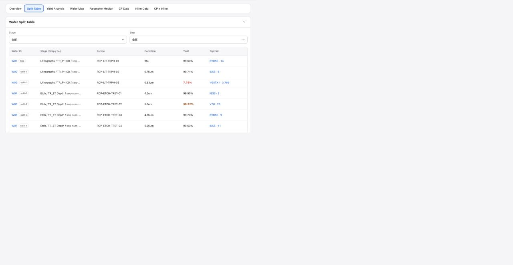

# Report Split Table

## Intake

- Component name: Report Split Table
- Sequence: 011
- Source page: `http://127.0.0.1:8888/DOE%20report.html`
- Parent prototype surface: `DOE Report`
- Source screenshot: `screenshot.png`
- Intake status: Raw prototype observation from user-directed browser review

## Screenshot



## User Notes

```text
除了左侧的侧边栏，重点是看右侧 各个 tabs 每个 tab 都是一个大业务组件，
然后 每个tab 里面 酌情分解。
```

This record treats the `Split Table` tab as one large report business component.
It is distinct from the earlier trial split-table creation component.

## Observed UI Region

The screenshot shows the `DOE Report` surface with the `Split Table` tab active.

Visible heading:

- `Wafer Split Table`

Visible controls:

- `Stage` selector, default `全部`
- `Step` selector, default `全部`

Visible table columns:

- `Wafer ID`
- `Stage / Step / Seq`
- `Recipe`
- `Condition`
- `Yield`
- `Top Fail`

Visible row themes:

- Wafer IDs such as `W01`, `W02`, `W03`.
- Baseline and split labels such as `BSL`, `split-1`, `split-2`.
- Recipe IDs such as `RCP-LIT-TRPH-01`.
- Condition values such as `BSL`, `0.75um`, `0.83um`.
- Yield values with visual severity.
- Top fail parameter links such as `BVDSS`, `IDSS`.

## Candidate Domain Boundary

Candidate responsibilities:

- Present a read-only report view of wafer split assignment and observed yield.
- Filter report rows by stage and step.
- Show wafer, stage, step sequence, recipe, condition, yield, and top fail
  summary in a dense inspection table.
- Expose row, wafer, and top-fail click intents for report drilldown.
- Preserve report evidence as displayed data rather than recalculating workflow
  state.

Out of scope during intake:

- No editing of split assignment, recipe, or condition.
- No MES release behavior.
- No ownership of experiment setup forms.
- No backend calculation of yield or top fail from raw die data inside the
  component.

## Candidate Decomposition

- Stage / step filter bar
- Report split table
- Wafer identity cell
- Stage / step / sequence cell
- Recipe and condition cells
- Yield severity cell
- Top fail link cell

## Open Questions

- Is this component backed by the same data model as the trial split-table
  creation component, or by a report-specific snapshot?
- What thresholds and color semantics should yield severity use?
- Should table rows be sortable by wafer, yield, stage, or top fail?
- Which drilldown target owns a click on `Top Fail`: CP Data, Parameter Median,
  Wafer Map, or a separate fail detail component?

## Post-intake Implementation Notes

- Current implementation treats this as a report-specific snapshot, not the
  editable trial split-table data model.
- Stage / Step filtering is local to `ReportSplitTable` in the current
  Component Lab preview.
- `Top Fail` is display data by default; drilldown can be exposed as callback
  intent, but the component does not own the target workflow.
- Yield severity follows the report convention used by current fixtures:
  `< 90%` bad, `90%-99.5%` watch, `>= 99.5%` good.
- The table uses the Layout Shell comfortable base-Table presentation (14px
  text, 40px transparent header, 8px cells). Wide report projections retain a
  local horizontal scroll container rather than changing page width.
- The 2026-09-22 table alignment uses the local `DOE Workbench 单文件版.html`
  `renderSplit` implementation as reference evidence. Rows are grouped by
  `Stage + Step + Seq`, Baseline renders first, split labels are assigned by
  distinct condition within the group, and source-provided `topFails` may show
  multiple CP parameters in one cell. Cross-tab navigation from the prototype
  remains outside this Domain UI component.

## 2026-09-22 Composition Correction

User annotation review established that `Wafer Yield & CP Fail Analysis` is
not part of the Split Table module. Split Table owns only its Stage / Step
filters and grouped comparison table. The chart contract and implementation
belong to `Report Yield Analysis`.

## 2026-09-23 Step Facet Contract

The Split Table has two intentionally separate source populations: authoritative
assignment facts and active display rows. The optional `stepFacets` input carries
the BFF-provided `step`, optional `stepSequence`, authoritative `sourceCount`, and active
`displayCount` in BFF sequence order. When present, the Step combobox and its
selected chips display both counts (for example, `CPX-S01 · 25 facts / 5
displayed`) while the local filter continues to operate only on injected active
`rows`. The component must not derive or substitute either count from those
rows.

## 2026-09-29 Nullable Yield Contract

Runtime evidence established that a Split Table assignment may not have a Yield
observation. The report-specific snapshot therefore models `yield` as
`number | null`: numeric zero remains a real `0.00%` observation, while `null`
renders as `Unavailable` with neutral tone. Consumers and adapters must not
coerce absent or null Yield to zero.

## 2026-10-09 Loading / Empty Pilot

User requested the supplied shadcn Spinner / Empty screenshot without Cancel.
The approved first slice is Split Table only. Loading uses a muted rounded icon
background, arc spinner, Chinese title and description; no data and filtered
empty use only centered text. Consumer request state remains outside the
component. See the Split Table MDX contract and its three status previews.

## 2026-10-10 Container alignment evidence

用户提供 Split Table 的 6 条对齐批注，随后纠正要求按容器边界量测，并明确确认以 Header 内容区为基准、桌面左右各 24px。原 App 1224px 下 Header / navigation 为 24px，而 Split filters / table shell 为 14px。该新证据修订工作区横向布局；具体 contract 见 Split Table MDX 的 container alignment pilot。原数据和局部表格交互不变。

## Business block title pilot — 2026-10-10

用户的新指令将业务模块称为 block，要求 header/title 与 body 上下组合，
并明确不采用原型 8888 的展开/收缩容器。Split Table 是本轮唯一标题试点：
`Wafer Split Table`，小问号悬浮/键盘聚焦显示本地 shadcn Base UI Tooltip。
说明按当前组件契约总结 Stage / Step / Seq 分组、六列 snapshot 事实、
BSL / split 分配角色和 Stage / Step 筛选，不新增推断事实。
共享 `BlockTitle` 契约见 `content/docs/domain/shared/block-title.mdx`，
锚点为 `wafer-split-table`，帮助按钮辅助标签为 `关于 Wafer Split Table`。

## 2026-10-13 user-approved Yield Matrix alignment

用户以运行中 Yield Matrix 截图为基准：短 Wafer 名称与角色灰字同行；Stage label 单独一行，Step label 与序号在下一行。名称只用于阅读，稳定身份用于分组、筛选和点击。具体可选字段与 fallback 见当前 Split Table MDX contract。
