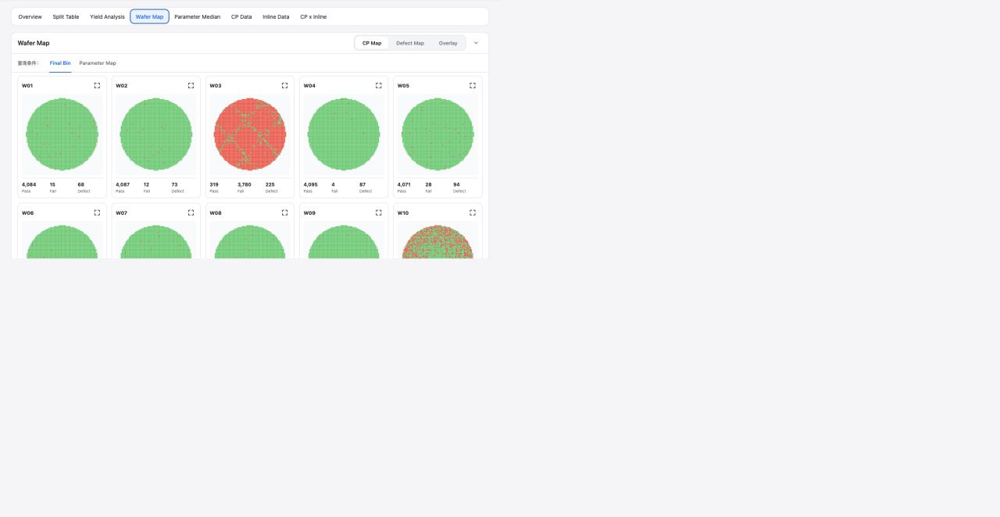

# Report Wafer Map

## Intake

- Component name: Report Wafer Map
- Sequence: 013
- Source page: `http://127.0.0.1:8888/DOE%20report.html`
- Parent prototype surface: `DOE Report`
- Source screenshot: `screenshot.png`
- Intake status: Raw prototype observation from user-directed browser review

## Screenshot



## User Notes

```text
除了左侧的侧边栏，重点是看右侧 各个 tabs 每个 tab 都是一个大业务组件，
然后 每个tab 里面 酌情分解。
```

This record treats the `Wafer Map` tab inside `DOE Report` as one large report
business component.

Important implementation constraint:

```text
Report Wafer Map must reuse the existing shared WaferMap component.
Do not rebuild wafer die geometry, canvas rendering, or map drawing logic here.
```

## Observed UI Region

The screenshot shows the `DOE Report` surface with the `Wafer Map` tab active.

Visible heading:

- `Wafer Map`

Visible controls:

- Map mode buttons: `CP Map`, `Defect Map`, `Overlay`
- Layer controls: `Final Bin`, `Parameter Map`
- Query condition label: `查询条件：`

Visible content:

- Multiple wafer cards such as `W01`, `W02`, `W03`.
- Circular wafer visualizations with die-level color patterns.
- Per-wafer metrics such as `Pass`, `Fail`, and `Defect`.
- Card-level expand or inspect affordances.

## Candidate Domain Boundary

Candidate responsibilities:

- Present a report-level grid of wafer maps for a DOE report.
- Compose the shared `WaferMap` component for wafer visualization.
- Switch between CP map, defect map, and overlay report modes.
- Switch report layer views such as final bin and parameter map.
- Display wafer-level pass, fail, and defect counts alongside each map.
- Expose wafer selection, expand, and mode-change intents through local
  callbacks.

Out of scope during intake:

- No new wafer geometry renderer.
- No duplicated canvas map drawing logic.
- No separate die-coordinate layout engine.
- No mutation of die, bin, defect, or parameter data.
- No backend fetch or data normalization.
- No assumption that report map modes are fully equivalent to the standalone
  Wafer component V1.

## Candidate Decomposition

- Report wafer map toolbar
- Map mode segmented control
- Layer switch
- Wafer card grid
- Wafer map card
- Shared `WaferMap` adapter / data mapping boundary
- Wafer metric footer
- Wafer expand / inspect action

## Open Questions

- What adapter data is needed to pass report wafer data into the shared
  `WaferMap` component?
- Which map modes and layers are required for V1?
- How are `Pass`, `Fail`, and `Defect` counts computed and passed in?
- What interaction is expected when a wafer card is expanded?
- Should selected parameters come from this tab, Parameter Median, or CP Data?

## Confirmed Expanded-Wafer Interaction (2026-09-22)

The user explicitly requested the click-to-expand view from
`DOE Workbench 单文件版.html`, including the table to the right of the enlarged
map. Prototype inspection confirmed:

- Every wafer card exposes an expand affordance.
- The expanded surface keeps the current map mode and wafer identity in its header.
- A large reusable wafer canvas occupies the left column, with zoom controls and
  previous/next wafer navigation.
- The right column starts with selected-Die details and ends with a mode-specific
  statistics table.
- Final Bin uses `Bin Code / Bin Des / Count / Rate` plus tested and failed Die totals.
- Parameter Map uses `Type / Count / Rate` for CP × defect classifications.
- Defect Map uses `Defect Type / Count / Rate` plus Defect Die and Defect Record totals,
  scoped by Layer.

The statistics are expected input facts. They are represented by mode-specific
`inspection` schemas and must not be inferred from missing backend fields by the
Report component.

## Lineage-informed inspection revision (2026-10-11)

User-approved evidence comes from the three wafer-map notebooks in
`db-probe/notebooks/computed fileds/wafer-map/`: `total_fail_bin_rate.ipynb`,
`parameter_cpk.ipynb` and `particle_rate.ipynb`. This supersedes the 2026-09-22
Parameter CP × Defect table interpretation above: Parameter inspection presents
single-wafer specifications and descriptive statistics plus capability. Exact
codes are distinct; `BVDSS_100u` is not an alias of `BVDSS`.

Final Bin inspection retains Tested / Fail Die and per-bin record totals/rates.
Defect inspection distinguishes records from defect-bearing Die, retains
unresolved numeric class identity, and includes outside-grid records in the
full inspection denominator. Record aggregates do not imply real IDs/images
have been delivered. Single-wafer Parameter and Layer selection emits existing
consumer intents. Overlay is visibly disabled. No Uniformity / Hi-Lo / Particle
Rate / image capability is introduced in this approved first slice.

## Approved WM02 completion (2026-10-11)

User approved completing the available first-slice gaps: Parameter inspection
also presents CP Tested / Pass / Fail counts and supplied rates from the same
CP test as the currently displayed Map. This is a separate input from parameter
valid sample N and selected-slice overview summary. Missing identities retain
unavailable state, and frontend never computes rates or fills counts from N.

## Approved WM03 / WM04 prototype formulas (2026-10-11)

Prototype evidence: `getWaferParameterStats` (lines 5189–5215) and
`renderWaferParameterSummary` (6132–6165) in the inspected DOE report HTML.
Statistics use raw Min / Max for Hi/Lo, rather than the prototype's P2/P98
display limits. Uniformity (RsU) = sample sigma / mean × 100%; Hi/Lo Var. =
(raw max − raw min) / (2 × mean) × 100%. User approved Backend Domain
computation on the production PHYSICAL_VALID population and nullable UI
delivery. Signed percentages are retained; mean zero stays unavailable.
This supersedes these two fields' earlier first-slice deferral.

## Approved WM06 / WM08 completion (2026-10-11)

Actual record IDs and numeric details can be delivered from the existing frozen
Defect map payload. UI opens these fields locally; images remain outside scope.
Separately, CP cards may show default-layer Defect Die counts with explicit
Layer and unavailable/empty states. These facts do not imply matching CP and
Defect coordinates or authorize Overlay rendering.
